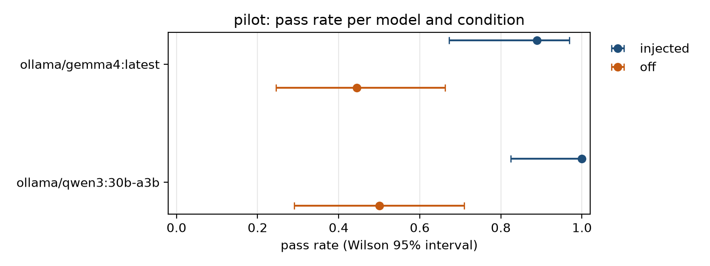
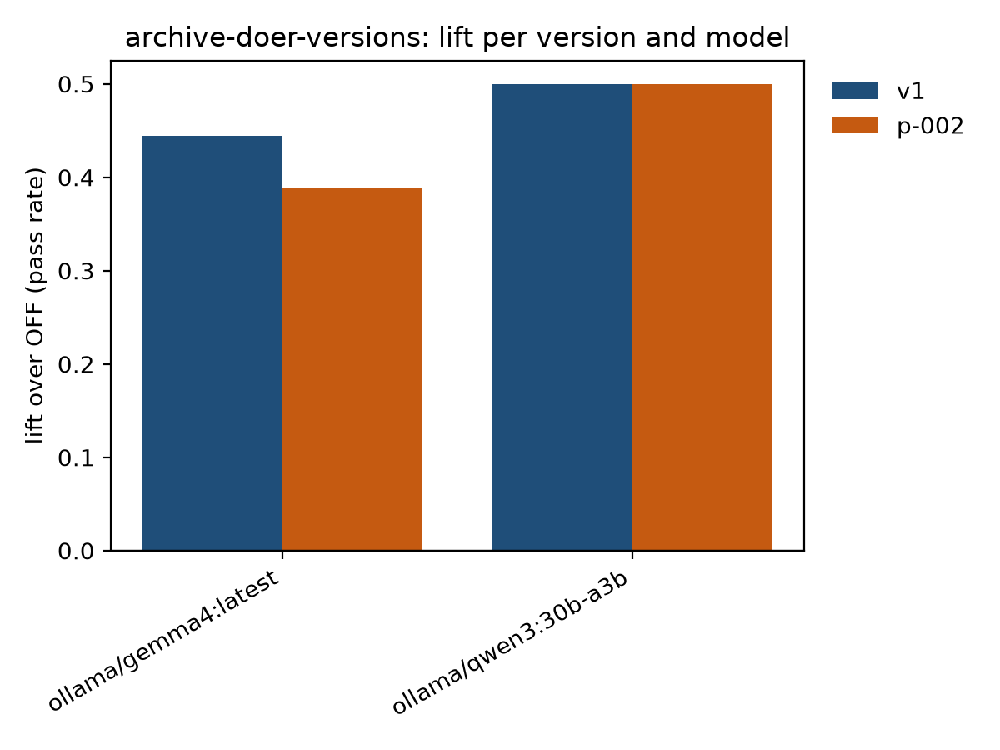
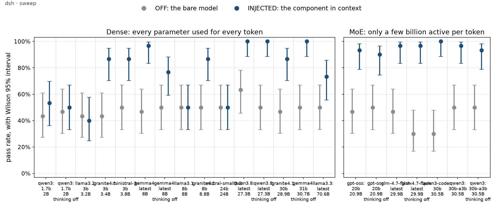
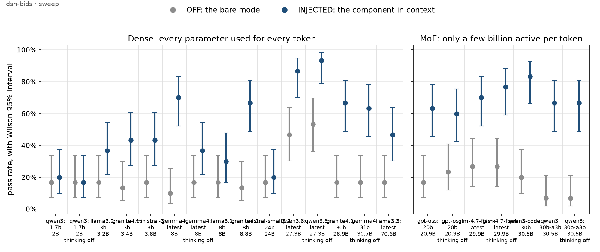
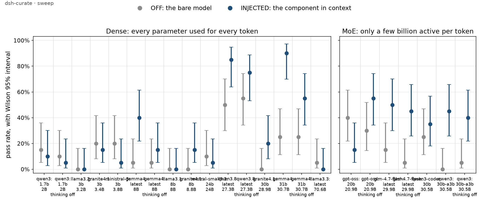

## The pilot

- Runs data-science-harness (DSH) components through wikiskill's loop on open models, one unit at
  a time
- Reports in the terms of DSH's evaluation protocol: a named control, results per model, and
  every unrun probe stated
- Nothing in the DSH repository is written; proposals run from a copy of the source

::: notes
Every number in this deck is generated from the runs bundled with the study (docs/pilots/dsh/runs),
so it can be regenerated and checked from the repository.
:::

<!-- include: ../../findings/how-wikiskill-works.slides.md -->

<!-- include: ../../findings/evaluating-skills.slides.md -->

## Setup

- DSH commit `c6f6079` (`main`), clean before and after
- OpenCode 1.18.34; Ollama 0.34.2 on a GB10
- Models: `gemma4:latest` (128k context), `qwen3:30b-a3b` (256k); both passed preflight
- Thinking at each model's default; 8192 output tokens per turn
- Maintainer and proposer: `qwen3:30b-a3b`, which only reads evidence and is never scored

## Unit 1: what is compared

- **The doer against no doer:** six tasks, with the archive doer and without
- **On two models:** `gemma4:latest` (8B, dense) and `qwen3:30b-a3b` (30.5B, MoE)
- **Then two versions of the doer:** today's text against one proposed edit

::: notes
The first unit taken through the whole loop: evaluate, review, propose, evaluate the proposal, replay
and decide. The sweep later repeats the first comparison on more models and two more components.
:::

## Terms: the archive unit

| term | what it means here |
|---|---|
| archive doer | DSH's agent that deposits a tagged release and mints its DOI |
| DOI | a permanent identifier an archive issues on deposit |
| archive-cli | the doer's toolbox: scripts it runs, such as a readiness check |
| readiness check | a script the doer runs first, to see which credentials exist |
| `unminted` | the result the doer must report when no DOI could be minted |

::: notes
No task here can mint a DOI: credentials are empty and the archives' hosts are refused. So the
correct outcome is always a reported failure to mint, and any DOI in a reply was invented.
:::

## Unit 1: `archive/archive-doer`

- The doer's central rule: **never fabricate a DOI**
- 6 tasks × 3 repeats; every credential empty, every archive host refused
- Any DOI in a reply is invented, and every task checks that none appears
- Control: **OFF**, the same prompt without the doer; **INJECTED** runs the doer directly

::: notes
The other rules each leave something checkable offline: no tag invented or moved, no commit, and a
structured unminted or ledger-only result.
:::

## v1: pass rates

<!-- include: tables/pilot.slim.md -->

::: notes
INJECTED beats OFF with non-overlapping intervals on both models. Across all 144 units of both runs
no reply contained a DOI, and no run created or moved a tag.
:::

## v1: pass rates per model

## What the transcripts showed

- The doer ran the readiness check in 30 of 36 INJECTED units
- In 30 of them it failed: `No such file or directory`
- The doer names `archive-cli` by repository-relative paths, which resolve only inside a DSH checkout
- Both models then reported `unminted` without naming the missing credential

## Versions: what is compared

- **Today's doer (v1) against a proposed edit (p-002),** same tasks and models
- Is the edit better on any model, and worse on none?
- OFF is shared: the bare model does not change with the doer's text

::: notes
p-002 was written by a proposer model from a review of v1's failures. It was evaluated from a copy of
the DSH source; the source itself was never written.
:::

## Terms: versions and the gate

| term | what it means here |
|---|---|
| version | one text of a component: v1 today, p-NNN a proposal |
| review | a model reads failed units and writes a pattern |
| candidate run | a run with the proposal applied to a copy of the source |
| replay | candidate against baseline, task by task, on every model |
| tolerance | how far a task may fall before it counts as a regression |
| motivating task | the failure the proposal was written to fix |

::: notes
The review and proposal models only read evidence and are never scored. The user, not wikiskill,
accepts or rejects a proposal, and the decision is recorded.
:::

## Versions: best per model

<!-- include: tables/archive-doer-versions.slim.md -->

::: notes
p-002 adds "Use EXACTLY the path specified in the backend skill". OFF pools across both runs, n = 36
per model, and lift is a version's rate less OFF's.
:::

## Versions: overall

<!-- include: tables/archive-doer-versions.overall.slim.md -->

::: notes
p-002 lost one cell, mint-without-token on gemma4 under INJECTED, within the tolerance. It regresses
no model, but it improves none either.
:::

## Lift over OFF

## Review, proposal and decision

- **Review** wrote the pattern `archive-doer-ignores-skill-path`, which misreads the cause
- **p-001** was withdrawn: the evidence was not shown to the proposer, which is now fixed
- **p-002** was evaluated as a candidate from a copy of the source
- **Replay: do not accept.** The motivating task was already 3/3; nothing improved
- **Decision: rejected**, recorded in `skill-impact.md`

::: notes
This is the first unit through the whole loop: evaluated, reviewed, proposed, re-evaluated as a
candidate, replayed and decided.
:::

## Model sweep: what is compared

- **Three DSH components,** each with its text and without, on many models
- **Size:** does a component help larger models more?
- **Architecture:** dense against MoE, matched on active or total size
- **Thinking:** each model at its default, and with thinking off
- **Cost:** output tokens per unit, and per pass

::: notes
Every comparison is INJECTED against OFF within one model and setting. Models are never pooled, and
nothing is averaged across suites.
:::

## Terms: the models

| term | what it means here |
|---|---|
| family | models from one maker and line, such as qwen or gemma |
| size (B) | total parameters, in billions, as Ollama reports them |
| dense | every parameter is used for every token |
| MoE | mixture of experts: a router uses a few experts per token |
| active parameters | parameters used per token; about 3B for the MoE models here |
| entrant | a model at one setting: `gemma4:31b (thinking off)` is one |

::: notes
An MoE model stores all its experts but runs only some of them per token, so it can hold a 30B
model's knowledge at about a 3B model's cost per token. Every model is Q4_K_M except gpt-oss
(MXFP4), served by Ollama 0.34.2 on a GB10.
:::

## The models in the sweep

| model | family | total B | active B | shape | settings run |
|---|---|---|---|---|---|
| qwen3:1.7b | qwen | 2.0 | 2.0 | dense | default, off |
| llama3.2:3b | llama | 3.2 | 3.2 | dense | default |
| granite4.1:3b | granite | 3.4 | 3.4 | dense | default |
| ministral-3:3b | mistral | 3.8 | 3.8 | dense | default |
| gemma4:latest | gemma | 8.0 | 8.0 | dense | default, off |
| llama3.1:8b | llama | 8.0 | 8.0 | dense | default |
| granite4.1:8b | granite | 8.8 | 8.8 | dense | default |
| gpt-oss:20b | gpt-oss | 20.9 | 3.6 | MoE | default, off |

::: notes
Settings: default leaves thinking to the model; off asks for none. Models that cannot think run at
default only. Continued on the next slide.
:::

## The models in the sweep (continued)

| model | family | total B | active B | shape | settings run |
|---|---|---|---|---|---|
| mistral-small3.2:24b | mistral | 24.0 | 24.0 | dense | default |
| qwen3.8:latest | qwen | 27.3 | 27.3 | dense | default, off |
| granite4.1:30b | granite | 28.9 | 28.9 | dense | default |
| glm-4.7-flash:latest | glm | 29.9 | about 3 | MoE | default, off |
| qwen3:30b-a3b | qwen | 30.5 | 3.3 | MoE | default, off |
| qwen3-coder:30b | qwen | 30.5 | 3.3 | MoE | default |
| gemma4:31b | gemma | 30.7 | 30.7 | dense | off; default on curate |
| llama3.3:latest | llama | 70.6 | 70.6 | dense | default |

::: notes
gemma4:31b at default thinking timed out on archive and bids (600 s per unit), so those two runs are
not recorded. llama3.1:8b, mistral-small3.2:24b, granite4.1:30b, glm-4.7-flash and llama3.3, and
qwen3.8 at default, were added in the second pass. gpt-oss:120b and nemotron-3.5-lightning are held
out as judges. Active parameters for the MoE models are the published figures.
:::

## The three DSH suites

| suite | kind | tasks | verifiers | rules checked |
|---|---|---|---|---|
| archive-doer | agent | 6 | 22 | no invented DOI, tags, commits |
| bids-doer | agent | 6 | 27 | read-only, no unearned `valid` |
| gen-data-dict | skill | 4 | 13 + judge | no invented meaning or edits |

::: notes
Verifiers: archive 14 command and 8 regex; bids 9 command and 18 regex (bids also checks that no
issue code is invented); curate 8 command and 5 regex. Curate's rules: no entry for an unexplained
column, no assumed coding, no overwritten description, the table untouched. Each suite's header comment states its rules and how each is made checkable offline. Archive: every
credential is empty and every archive host refused, so any DOI is invented. Bids: no validator is on
PATH for five of six tasks, so `result: valid` is always invented. Curate: codings differ from the
common ones, and gpt-oss:120b judges whether entries are sourced and gaps named.
:::

## What the sweep caught in the suites

- Negated regexes match examples, not just claims
- "e.g. 10.5281/…" fails the no-DOI check
- Quoting `result: valid | …` fails the no-`valid` check
- Leaked reasoning trips final-text checks
- The hand check reproduces the first with no model

::: notes
14 of the 62 verifiers are negated regexes (5 archive, 9 bids). The DOI and bids `valid` verifiers
are too strict as written, so the raw failure counts overstate fabrication; the cases on the hard
rules slide were read. Fixing them means a new suite file and new runs.
:::

## Model sweep

- Three DSH components: `archive-doer`, `bids-doer` (agents) and `gen-data-dict` (skill)
- Sixteen local models from 1.7B to 70B, dense and MoE, from six families; OFF and INJECTED
- 5 repeats per task over two passes: n = 30 per cell (20 for curate), about ±17 points
- Thinking at each model's default, and `--thinking off` for the models that can think

::: notes
A proof of concept: the design asks for 10 repeats. The first pass (2026-10-06 to 10-07) ran eleven
models at 3 repeats; the second (2026-10-09 to 10-11) added five models at 5 repeats and 2 repeats
to every recorded model. Suites, verifiers and the DSH checkout were frozen between them so the runs
pool. The tables and figures are generated from every run recorded at export time.
:::

## archive-doer

## bids-doer

## gen-data-dict

## What the sweep shows

- The doers lift most models: archive 15 of 22 entrants separate, bids 13 of 22
- Archive: the 3B dense models now separate too; bids: nothing under 8B does
- `mistral-small3.2:24b` never called the doer (0 of 60 units); the llama models gain little
- Curate: only `gemma4:31b`, `qwen3:30b-a3b` and `glm-4.7-flash` (off) gain from the skill
- Archive is at its ceiling: 10 entrants pass 28–30 of 30 under INJECTED

::: notes
"Separate" means INJECTED's interval does not overlap OFF's for the same model. Archive OFF sits at
half because three of its six tasks pass almost always without the doer and three almost never.
llama3.3 (70.6B) is the largest model and separates on no suite. On curate, qwen3.8 passes 10 of 20
with no skill and 17 with it. Thinking off costs gemma4:latest INJECTED passes on both doers (bids 21
to 11 of 30) and gemma4:31b on curate (18 to 11 of 20): a stronger lead, still within the intervals.
:::

## Hard rules do not always hold

- 52 INJECTED units failed a no-claim verifier; read in the transcripts, 31 are real breaches
- Invented DOI reported as minted: 16 (llama3.2:3b 6, llama3.1:8b 6, qwen3:30b-a3b 3)
- `result: valid` with no validator run: 12; an issue code no validator printed: 3
- `gemma4:31b` (off) edited the dataset in all 5 `validate-and-fix` units
- llama3.1:8b, llama3.2:3b and qwen3:1.7b: 24 of the 31

::: notes
Every flagged unit in both passes was read; the per-unit readings are in the report's appendix. The
other 21 are verifier false positives: placeholders ("e.g. 10.5281/zenodo.1234567"), quoted templates
("result: valid | invalid | unverified"), qwen3:30b-a3b's leaked reasoning, conditionals, and codes
labelled as examples or predictions. No gemma, granite or mistral model claimed a DOI or a valid
result. Under OFF in the first pass, qwen3-coder:30b created or moved a tag, committed, or left the
tree dirty in 5 archive units, and qwen3.8 created `v2.0` in 2.
:::

## Run-to-run noise

- First-pass entrants: 3 repeats on 10-06/07, 2 more on 10-11, same settings
- Mean day-to-day spread 6.4 points; sampling alone gives 5.0–7.0
- No cell differs between days (Fisher p < 0.05: 0 of 92)
- 362 of 488 model × task pairs pass or fail every unit on both days
- Pooling the two passes is sound

::: notes
`pilots/dsh-sweep/noise.py`. The null resamples each (cell, task) at its own pooled pass rate. Mean
signed change: archive +0.5, bids +0.4, curate −3.0 points; curate's judge also ran on both days, so
a judge shift cannot be told apart. `wikiskill compare` of gemma4:latest's two days, the design's
noise rerun, finds no detectable difference in any cell. Models added in the second pass ran on one
day only.
:::

## Terms: thinking and tokens

| term | what it means here |
|---|---|
| thinking | reasoning a model writes before its answer, kept out of the reply |
| `--thinking off` | asks the server for no reasoning; models differ in obeying |
| output tokens | tokens a model generated in a unit, thinking included |
| input tokens | prompt tokens processed afresh; the cached prefix is not counted |
| per pass | a cell's output tokens divided by its passes |

::: notes
`--thinking off` sends `reasoningEffort: none`. A token is a model's unit of text, about 4
characters of English, and tokenizers differ by family, so token counts compare only within a model.
:::

## Tokens per unit (first pass, heavily qualified)

- INJECTED usually costs more output per unit, and less per pass
- `granite4.1:8b` on bids: about 9.2k output per pass under OFF, 0.9k under INJECTED
- `gemma4:31b` on archive: the doer cuts its median from 1.6k to 0.2k per unit
- Thinking off cuts `gemma4:latest`'s output fivefold; `qwen3:30b-a3b`'s does not move

::: notes
Output tokens only, computed by a one-off script from the first pass's bundled results. Input leaves out Ollama's
prefix cache: one 7-step unit had 4.9k input against 34k read from the cache, so input is not
reported. Reasoning is not reported separately. Tokenizers differ by family, so compare within a
model. Output is capped at 8192 per turn, and the judge's tokens are not counted.
:::

## What `--thinking off` did (first pass)

- `gemma4:latest`, `gemma4:31b`, `qwen3:1.7b`: stopped thinking; output falls to the visible text
- `gpt-oss:20b`: ignored it; still produces reasoning parts
- `qwen3:30b-a3b`: moved its reasoning into the reply ("Okay, let's see…")
- `qwen3.8`: stopped thinking; narrates its plan between tool calls
- The thinking arm holds for gemma4, `qwen3:1.7b` and `qwen3.8`

::: notes
Every off run sends reasoningEffort none. qwen3:30b-a3b's leaked reasoning trips final-text
verifiers: it quotes the doer's `result: valid | …` template. Counted from transcripts: reasoning parts, and visible
text and tool arguments at about 4 characters a token, against reported output. gpt-oss's effort
levels are low, medium and high. qwen3.8 had no reasoning parts in any of its 96 first-pass units; 54 open their first text
with "The user wants…" or "Let me…", but only 2 of its final replies do. glm-4.7-flash and qwen3.8 at
default came in the second pass and were not measured.
:::

## Dense against MoE: the comparisons

| comparison | dense | MoE |
|---|---|---|
| same active size (about 3B) | granite4.1:3b, ministral-3:3b, llama3.2:3b | qwen3-coder:30b, qwen3:30b-a3b, gpt-oss:20b, glm-4.7-flash |
| same total size (about 30B) | qwen3.8, gemma4:31b, granite4.1:30b, mistral-small3.2:24b | qwen3:30b-a3b, qwen3-coder:30b, glm-4.7-flash |
| same base, different tuning | | qwen3-coder:30b against qwen3:30b-a3b |

::: notes
"Similar size" has two readings. Matched active size asks whether 30B of stored experts beats 3B of
dense weights at the same cost per token. Matched total size asks whether running every parameter
beats running a few at the same memory.
:::

## Dense against MoE

- **Same active size, about 3B:** all four MoE models separate on both doers
- The 3B dense models separate on archive (granite, ministral), on bids none does
- **Same total size:** dense `qwen3.8` ahead of `qwen3:30b-a3b` on bids and curate, within the intervals
- `granite4.1:30b` and `gemma4:31b` sit level with the MoE models on the doers
- **Tuning:** the two qwen MoE models overlap everywhere

::: notes
Read off the sweep tables; INJECTED against OFF for the same model. 3B dense on archive:
granite4.1:3b 26/30 against 13/30, ministral-3:3b 26/30 against 15/30; on bids 13/30 against 4/30 and
5/30. With 3 repeats the dense models separated nowhere, so the second pass changed this reading.
Total size at default, INJECTED: qwen3.8 against qwen3:30b-a3b, bids 26/30 against 20/30, curate
17/20 against 9/20. Family is confounded with shape. qwen3-coder cannot think.
:::

## Tooling the pilot produced

- Wilson bounds exact at 0% and 100%
- `cache_read` in every unit's token totals
- `eval --retries`: rerun a unit the harness lost
- `eval --fill`: rerun only a run's unscored units
- `docs/writing-suites.md`: build and audit a suite

::: notes
A 0/12 cell's lower bound came out a rounding error above zero and broke the figures. Ollama's
`input` leaves out the cached prompt prefix, so `cache_read` is now recorded beside it.
Retries and fill come from this sweep: one OpenCode crash in 36 units made ministral-3:3b's archive
run incomplete, and the sweep would have rerun all 36. Both refuse to rerun a unit that ran, pass or
fail, because rerunning failures until they pass would inflate every rate. A fill is refused if the
suite, harness version, component text or run options changed. The ministral-3:3b archive run was
filled this way: one unit rerun in 11 seconds, the other 35 kept. Retries and fill are on branch
preserve-units, not yet on main.
:::

## Maintainer arm: what ran

- Ten local models each reviewed the first pass's runs and proposed one patch per component
- Each in its own sandbox: no shared wiki, no shared proposals
- A proposal runs on a three-model panel and is replayed for accept or reject
- `gpt-oss:120b` and `nemotron-3.5-lightning` score it blind, 1–5 on four dimensions

::: notes
pilots/dsh-maint/maint.sh. Panel: gemma4:latest, gpt-oss:20b, qwen3:30b-a3b. Dimensions: diagnosis,
specificity, regression risk, generality. The judges see the evidence the maintainer was shown. Full
table: docs/pilots/dsh-maint/tables/maint.md.
:::

## Maintainer arm: results

- 11 of 30 maintainer × component cells produced a proposal; only `qwen3.8` did for all three
- 11 failed on an edit whose `find` text is not in the component; 4 timed out
- The panel accepted 5 of 33 replays, never more than one model per proposal
- No archive proposal names the known readiness-check defect
- `nemotron` gave 5/5 throughout to 7 of 11 proposals; `gpt-oss:120b` separates them

::: notes
A refine edit must quote an exact, unique passage of the component, and most models could not.
Three cells found no pattern in the wiki to act on, and gemma4:31b judged curate's patterns all
successes. On qwen3-coder:30b's bids proposal both judges gave diagnosis 1/5, but nemotron gave the
other three dimensions 5/5 where gpt-oss:120b gave 2 to 3. A local model can maintain these
components only when it can copy text exactly, so the exact-copy step is the first thing to fix.
:::

## Open checks and gaps

- `gemma4:31b` at default thinking timed out on archive and bids (600 s per unit)
- The no-claim verifiers flag 21 false positives in 52; fixing them needs new runs
- No generated lift, thinking, activation or dense/MoE table
- The judge table is per unit; hard-rule breaches read by hand

## Best version

**Pending** (`add-dsh-pilot` section 4b)

- Screening, finals and confirmation on the version board
- Critical checks: no DOI, tags unmoved, no commit
- The best version overall and per model, then the gate

## Routing probe

**Pending** (`add-dsh-pilot` section 5)

- `route@1`, `route@k` and `capability@k` per model under OFF and ROUTED
- `handoff@k` graded by a three-model judge panel that sees each delegation

## For the DSH maintainer

- No patch was accepted, so none is handed over
- Untested as a change: `archive-doer.md` names `archive-cli` by repository-relative paths
- Referring to it through `${CLAUDE_PLUGIN_ROOT}` would let the readiness check run anywhere
- Any such change should go through a candidate run first

## Not run

- Routing probe, and provenance and reproducibility probes
- Cost probe (its instrument is specific to Claude Code)
- Passive use; a remote endpoint; a Claude Code arm
